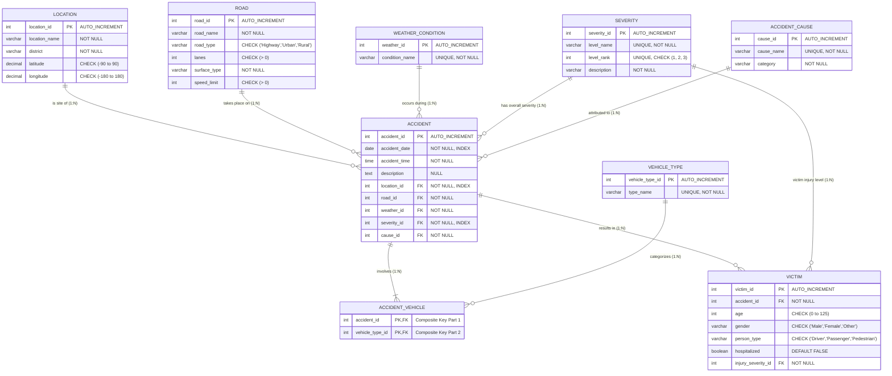

# Road Accident Hotspot Analysis and Severity Prediction System
## Architecture & Technical Specification Document

---

## 1. Executive Summary & Project Purpose

The **Road Accident Hotspot Analysis and Severity Prediction System** is a full-stack database application designed to:
1. **Identify Collision Hotspots**: Empirically calculate risk scores across geographical coordinates to pinpoint hazardous traffic zones.
2. **Analyze Multidimensional Crash Factors**: Uncover correlations between crash severities and road infrastructure, weather conditions, driving violations, and diurnal timing bands.
3. **Predict Accident Severity**: Provide history-based probabilistic predictions of accident severity (*Minor*, *Serious*, *Fatal*) given road characteristics, environmental state, and primary cause using an in-database MySQL Stored Procedure.
4. **Ensure ACID Integrity**: Guarantee atomicity and consistency when registering multi-vehicle collisions and injury records across junction tables via relational transactions.

---

## 2. High-Level System Architecture

The application adopts a clean three-tier architecture:

```
┌────────────────────────────────────────────────────────────────────────┐
│                   PRESENTATION TIER: React SPA                         │
│  - Vite + React (JavaScript, Port 5173)                                │
│  - Recharts Visualization Suite                                        │
│  - Modules: Hotspots Ranking, Predictor, Analytics, Add Incident      │
└───────────────────────────────────┬────────────────────────────────────┘
                                    │ HTTP / REST / JSON (Fetch API)
┌───────────────────────────────────▼────────────────────────────────────┐
│                    APPLICATION TIER: Express Backend                   │
│  - Node.js + Express (Port 5000)                                       │
│  - Connection Pool: mysql2/promise (10 connections max)                │
│  - Security: 100% Parameterised SQL Queries (No SQLi)                  │
│  - Transaction Control: BEGIN TRANSACTION, COMMIT, ROLLBACK            │
└───────────────────────────────────┬────────────────────────────────────┘
                                    │ MySQL Native Protocol (TCP / Socket)
┌───────────────────────────────────▼────────────────────────────────────┐
│                     DATABASE TIER: MySQL 8 (3NF)                       │
│  - Database: accident_db                                               │
│  - 9 Relational Entities (Normalized to 3NF)                           │
│  - Analytical View: v_hotspot_ranking                                  │
│  - Prediction Stored Procedure: sp_predict_severity                    │
│  - B-Tree Performance Indexes                                          │
└────────────────────────────────────────────────────────────────────────┘
```

---

## 3. Entity-Relationship (ER) Diagram



---

## 4. Normalization Analysis (Third Normal Form - 3NF)

The schema satisfies all criteria for Third Normal Form (3NF):

### 1NF (First Normal Form)
- **Atomic Values**: Every cell holds a single indivisible attribute value (e.g., latitude and longitude are stored separately as numbers, not combined coordinates).
- **No Repeating Groups**: Multiple vehicles in a collision are not stored as comma-separated strings; they are isolated in the associative relation `accident_vehicle`.
- **Primary Keys**: Every relation defines an explicit primary key (`AUTO_INCREMENT` or composite).

### 2NF (Second Normal Form)
- Meets all 1NF rules.
- **No Partial Dependencies**: In tables with composite keys (specifically `accident_vehicle(accident_id, vehicle_type_id)`), there are no non-key attributes dependent on only part of the candidate key.

### 3NF (Third Normal Form)
- Meets all 2NF rules.
- **No Transitive Dependencies ($X \to Y \to Z$)**: Non-key attributes depend solely on the primary key, the whole key, and nothing but the key.
  - Road attributes (`road_type`, `speed_limit`) belong to `road`, not duplicated inside `accident`.
  - Weather details belong to `weather_condition`.
  - Severity weights (`level_rank`, `description`) belong to `severity`.
  - Cause categories belong to `accident_cause`.

---

## 5. Database Layer Implementation Details

### Table Inventory

| Table | Type | Rows (Sample) | Primary Key | Key Relationships |
| :--- | :--- | :--- | :--- | :--- |
| `location` | Master Entity | 10 | `location_id` | Referenced by `accident` |
| `road` | Master Entity | 8 | `road_id` | Referenced by `accident` |
| `weather_condition` | Lookup | 5 | `weather_id` | Referenced by `accident` |
| `severity` | Lookup | 3 | `severity_id` | Referenced by `accident`, `victim` |
| `accident_cause` | Lookup | 6 | `cause_id` | Referenced by `accident` |
| `vehicle_type` | Lookup | 5 | `vehicle_type_id` | Referenced by `accident_vehicle` |
| `accident` | Event Fact Entity | 840 | `accident_id` | References 5 master tables |
| `accident_vehicle` | Associative Junction | 1,310 | `(accident_id, vehicle_type_id)` | Resolves M:N Accident ↔ Vehicle Type |
| `victim` | Dependent Entity | 1,131 | `victim_id` | Child of `accident`, references `severity` |

### Database Constraints & Safeguards
- **Coordinate Bounds**: `CHECK (latitude BETWEEN -90 AND 90 AND longitude BETWEEN -180 AND 180)` ensures invalid GPS data cannot enter the system.
- **Enumerated Domains**: `CHECK (road_type IN ('Highway', 'Urban', 'Rural'))`, `CHECK (gender IN ('Male', 'Female', 'Other'))`, `CHECK (person_type IN ('Driver', 'Passenger', 'Pedestrian'))`.
- **Referential Integrity**:
  - `ON UPDATE CASCADE ON DELETE RESTRICT` protects lookup catalogs from orphan record deletions.
  - `ON UPDATE CASCADE ON DELETE CASCADE` on `accident_vehicle` and `victim` ensures child records are automatically removed if a parent incident is purged.

### Performance Indexes
- `idx_accident_location (location_id)`: Accelerates geographic hotspot grouping in `v_hotspot_ranking`.
- `idx_accident_date (accident_date)`: Optimizes chronological monthly time-series analytics.
- `idx_accident_severity (severity_id)`: Accelerates filtering by fatal/serious crash conditions.

---

## 6. Advanced SQL Objects

### 1. View: `v_hotspot_ranking`
```sql
CREATE OR REPLACE VIEW v_hotspot_ranking AS
SELECT 
    l.location_id,
    l.location_name,
    l.district,
    l.latitude,
    l.longitude,
    COUNT(a.accident_id) AS total_accidents,
    SUM(CASE WHEN s.level_name = 'Fatal' THEN 1 ELSE 0 END) AS fatal_count,
    COALESCE(SUM(s.level_rank), 0) AS risk_score
FROM location l
LEFT JOIN accident a ON l.location_id = a.location_id
LEFT JOIN severity s ON a.severity_id = s.severity_id
GROUP BY l.location_id, l.location_name, l.district, l.latitude, l.longitude
ORDER BY risk_score DESC, total_accidents DESC;
```
- Computes **Risk Score** $\sum(\text{level\_rank})$ where *Minor* = 1, *Serious* = 2, *Fatal* = 3.
- Highlights dangerous spots where high fatality rates occur, even if total collision count is lower.

### 2. Stored Procedure: `sp_predict_severity`
A parameterised predictive model written in MySQL procedural SQL:
```sql
CALL sp_predict_severity(
    p_road_type,   -- 'Highway' | 'Urban' | 'Rural'
    p_weather_id,  -- 1: Clear, 2: Rain, 3: Fog, etc.
    p_cause_id,    -- 1: Over-speeding, 2: Drunk Driving, etc.
    p_hour_band    -- 'Morning' | 'Afternoon' | 'Evening' | 'Night'
);
```
- **Diurnal Classification**: Internally evaluates `accident_time` using `CASE WHEN HOUR(accident_time)` to group events into four standard diurnal bands.
- **Empirical Probability Matching**: Calculates sample counts and percentages for *Minor*, *Serious*, and *Fatal* occurrences under matching conditions.
- **Fallback Safeguard**: If no exact four-dimensional scenario match is found in past data, it automatically computes probabilities against the global baseline distribution.

---

## 7. Backend Tier Architecture ([backend/server.js](file:///Users/makarandkulkarni/Myspace/DBMS_Project/accident-dbms/backend/server.js))

### Connection Pooling ([backend/db.js](file:///Users/makarandkulkarni/Myspace/DBMS_Project/accident-dbms/backend/db.js))
Uses `mysql2/promise` with:
- Connection pool limit: `10`
- Reuses socket handshakes, minimizing latency for concurrent clients.
- `decimalNumbers: true` ensures financial/coordinate decimals are emitted as native numbers in JSON.

### REST API Endpoints

| Method | Route | Description | SQL Execution |
| :--- | :--- | :--- | :--- |
| `GET` | `/api/hotspots` | Ranked hotspots | `SELECT * FROM v_hotspot_ranking;` |
| `GET` | `/api/stats` | Aggregated metrics | 4 parallel queries (`Promise.all`) grouped by cause, weather, month, and hour band |
| `GET` | `/api/lookups` | Dropdown catalogs | Parallel queries across lookup tables |
| `POST` | `/api/predict` | Run severity predictor | `CALL sp_predict_severity(?, ?, ?, ?);` |
| `POST` | `/api/accidents` | Insert accident event | Multi-table ACID Transaction (`BEGIN`, `COMMIT`, `ROLLBACK`) |

### ACID Transaction Flow (`POST /api/accidents`)
```javascript
const connection = await pool.getConnection();
await connection.beginTransaction();
try {
  // Step 1: Insert core event into accident
  const [accResult] = await connection.query(insertAccidentSql, [...]);
  const newAccidentId = accResult.insertId;

  // Step 2: Insert 1 to N vehicles into accident_vehicle
  for (const vTypeId of vehicle_type_ids) {
    await connection.query(insertVehicleSql, [newAccidentId, vTypeId]);
  }

  // Step 3: Insert 0 to N victims into victim
  if (victims?.length) {
    for (const v of victims) {
      await connection.query(insertVictimSql, [newAccidentId, v.age, v.gender, ...]);
    }
  }

  await connection.commit(); // Atomic commit across all 3 tables
} catch (error) {
  await connection.rollback(); // Immediate rollback if any insert fails
} finally {
  connection.release(); // Returns connection to the pool
}
```

---

## 8. Frontend Tier Architecture ([frontend/src](file:///Users/makarandkulkarni/Myspace/DBMS_Project/accident-dbms/frontend/src))

Built using **Vite + React (Plain JS)**, **Recharts**, and a single consolidated stylesheet ([App.css](file:///Users/makarandkulkarni/Myspace/DBMS_Project/accident-dbms/frontend/src/App.css)):

### Component Decomposition
1. **[App.jsx](file:///Users/makarandkulkarni/Myspace/DBMS_Project/accident-dbms/frontend/src/App.jsx)**: Header and tab bar state manager (`activeTab`: `'hotspots'`, `'predict'`, `'analytics'`, `'add'`).
2. **[Hotspots.jsx](file:///Users/makarandkulkarni/Myspace/DBMS_Project/accident-dbms/frontend/src/components/Hotspots.jsx)**:
   - Renders ranked table from `v_hotspot_ranking`.
   - Top 3 hazard rows highlighted in red with `HIGH RISK` badges.
   - Recharts responsive bar chart of accident and fatal distributions per location.
3. **[Predict.jsx](file:///Users/makarandkulkarni/Myspace/DBMS_Project/accident-dbms/frontend/src/components/Predict.jsx)**:
   - Dynamic form pulling options from `/api/lookups`.
   - Visual result card with colored badge (**Green** = Minor, **Orange** = Serious, **Red** = Fatal).
   - Horizontal CSS probability bars showing percentage distribution per severity level.
4. **[Analytics.jsx](file:///Users/makarandkulkarni/Myspace/DBMS_Project/accident-dbms/frontend/src/components/Analytics.jsx)**:
   - Chart 1: Bar chart of Accidents and Fatalities by Cause.
   - Chart 2: Stacked Bar chart of Minor/Serious/Fatal distribution by Weather Condition.
   - Chart 3: Monotone Line chart of Monthly Incident Trends (2023–2025).
5. **[AddAccident.jsx](file:///Users/makarandkulkarni/Myspace/DBMS_Project/accident-dbms/frontend/src/components/AddAccident.jsx)**:
   - Multi-input transactional incident entry form.
   - Allows vehicle multi-selection (checkbox pills).
   - Real-time client validation and transaction success/error banners.

---

## 9. Security, Reliability & Best Practices

1. **SQL Injection Prevention**: All queries in backend use parameterised placeholders (`?`). No string concatenation is used for user inputs.
2. **macOS Port Isolation**: The backend explicitly binds to IPv4 loopback (`127.0.0.1:5000`) to prevent collisions with the macOS AirPlay Receiver daemon listening on IPv6 `::1:5000`.
3. **Graceful Error Handling**: Every route wraps database operations in `try/catch` and returns HTTP status codes (`400` for validation issues, `201` for creation, `500` for internal server errors).
4. **Modular Styling**: All styles are consolidated into a single vanilla CSS file without external CSS frameworks, maintaining optimal load speed and zero bundle bloat.
